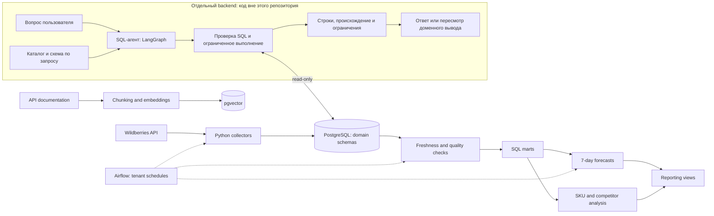

# ETL-WB — Wildberries Data Platform

Платформа на Python для загрузки данных продавца Wildberries в PostgreSQL, построения аналитических витрин и расчёта прогнозов. Apache Airflow связывает сбор данных, проверки качества и ежедневные расчёты в управляемые пайплайны.

В связанном backend добавлен SQL-агент на LangGraph: он получает бизнес-вопрос, изучает каталог доступных источников, составляет SQL и возвращает результат с ограничениями. В этом репозитории опубликован ETL-слой; устройство и границы интеграции описаны в [SQL-агенте](docs/sql-agent.md).

Эта версия подготовлена для портфолио: исходный код и SQL сохранены, кабинеты заменены демонстрационными, рабочие выгрузки, секреты и обученные модели исключены.

## Что решает проект

Данные продаж, остатков, рекламы и финансов поступают из разных API и обновляются с разной частотой. Проект собирает их в общей базе, сохраняет историю срезов и подготавливает данные для анализа товаров, рекламных расходов, цен и спроса.

| Направление | Реализация |
| --- | --- |
| Сбор данных | Заказы, продажи, остатки, поставки, цены, тарифы, акции, финансы, воронка продаж, реклама и поисковые запросы |
| Оркестрация | Ежедневные и почасовые DAG, зависимости между этапами, отдельные расписания кабинетов |
| Хранение | PostgreSQL, доменные SQL-схемы, upsert, сохранение прогресса и истории срезов |
| Качество | Проверки свежести источников и валидация аналитических витрин |
| ML | Обучение моделей заказов и выкупов на горизонт 7 дней, временная holdout-выборка, ежедневный скоринг |
| AI-анализ | Анализ SKU, подбор и фильтрация конкурентов, текстовая и визуальная оценка релевантности, объяснения прогнозов |
| SQL-анализ по вопросу | Отдельный backend с LangGraph: выбор источников, генерация и проверка SQL, ограниченное чтение, результат с происхождением и ограничениями; [статус интеграции](docs/sql-agent.md#статус-и-проверки) |
| Поиск по документации | Парсинг API-документации, разбиение на фрагменты, embeddings и поиск через pgvector |

## Архитектура



[Подробная архитектура и границы компонентов](docs/architecture.md) · [Цикл работы SQL-агента](docs/sql-agent.md).

## Инженерные решения

- **Возобновление загрузок.** Модули сохраняют прогресс, чтобы продолжать обработку после прерывания. Политики повторов и ограничения API учитываются в сборщиках; общая логика ожидания вынесена в `wb_api_support.py`.
- **История данных.** Продажи записываются через upsert по идентификатору и часу среза. Конкретные ключи и правила загрузки определяются каждым источником.
- **Контроль перед расчётами.** Основной DAG проверяет свежесть источников перед построением витрин и прогнозированием.
- **Несколько кабинетов.** Реестр tenants задаёт подключения и расписания. Задания запускаются с отдельным окружением и каталогом runtime; инфраструктура предусматривает отдельные БД.
- **SQL как часть проекта.** Определения таблиц, представлений и проверки качества хранятся рядом с кодом.
- **Отдельные контуры загрузки и исследования.** Airflow обновляет источники и витрины по расписанию; SQL-агент в backend читает разрешённые данные по вопросу пользователя. Числовые бизнес-формулы и прогнозы остаются в существующих расчётах, исследовательский SQL сопровождается ограничениями.
- **Разделение ML и LLM.** Численные прогнозы рассчитывает ML-слой, текстовые объяснения формируются отдельным этапом.

## Структура

```text
orders/                 # Заказы
sales/                  # Продажи и возвраты
stocks/                 # Остатки
supplies/               # Поставки
prices/                 # Цены
finance/                # Финансовые отчёты
marketing/              # Реклама и маркетинговые витрины
sales_funnel/           # Воронка продаж
search_queries/         # Поисковые запросы
promotions/             # Акции
tariffs/                # Тарифы
ML/                     # Обучение, прогнозы, объяснения
WB_sku_ai_analysis/     # Анализ карточек и конкурентов
wb_price_ai_analysis/   # Сравнение цен и релевантности товаров
airflow_home/dags/      # Оркестрация
tables/                 # Доменные схемы и SQL-витрины
tenants/                # Реестр и окружения кабинетов
scripts/                # Запуск заданий, provisioning, документация и RAG
tests/                  # Автоматические проверки ETL
docs/                   # Архитектура платформы и интеграция SQL-агента
```

## Как познакомиться с кодом

1. [Основной ежедневный DAG](airflow_home/dags/dag_daily_pipeline_master.py): последовательность обработки и проверки.
2. [Запись продаж](sales/database.py): нормализация, upsert и сохранение прогресса.
3. [Карта SQL-схем](tables/DOMAIN_SCHEMA_MAP.md): распределение данных по доменам.
4. [ML pipeline](ML/pipeline.py): обучение, валидация и прогнозы.
5. [Tenant runtime](tenants/runtime.py): окружения и каталоги отдельных кабинетов.
6. [SQL-агент](docs/sql-agent.md): каталог, чтение данных, границы исполнения и подтверждённый статус.
7. [Тесты](tests/): обработка ограничений API, преобразования данных, расчёты и структура DAG.

## Локальная проверка

Рекомендуется Python 3.11. Для Airflow используйте отдельное окружение или Docker: зависимости Airflow требуют согласованных версий.

```bash
python3.11 -m venv .venv
source .venv/bin/activate
python -m pip install -r requirements.txt
python -m pip install 'apache-airflow==2.9.0' \
  --constraint https://raw.githubusercontent.com/apache/airflow/constraints-2.9.0/constraints-3.11.txt
python -m pytest -q
```

Тестовые значения окружения задаются в `tests/conftest.py`. Реальные токены для unit-тестов не нужны. Некоторые тесты импортируют Airflow DAG, поэтому Airflow требуется и для полного набора тестов.

## Запуск с собственными данными

```bash
cp .env.example .env
docker compose up -d
```

Заполните `.env` своими настройками. База доступна локально на порту `55433`. Для загрузки данных нужен токен продавца WB с доступом к соответствующим API; AI-модулям отдельно требуется ключ OpenAI.

Перед запуском Airflow настройте `tenants/registry.yaml`: демонстрационный кабинет `demo` не подключён к реальной БД. Запись `legacy-default` соответствует локальной БД `wb-shared-db` в Docker. Оставляйте активными только настроенные кабинеты.

```bash
docker compose -f docker-compose.airflow.yml up -d
```

Airflow UI: `http://localhost:8082`. Текущий Compose предназначен для локальной разработки; учётная запись UI — `admin` / `admin`. Не используйте эти настройки для публичного сервера.

Полный расчёт требует загрузки истории источников и SQL-витрин. Пустая база не является готовым демо аналитики. Подробности отдельных загрузок находятся в README соответствующих модулей.

## Поиск по API-документации

Сгенерированная документация не включена в репозиторий. Её можно получить парсером:

```bash
python -m playwright install chromium
python scripts/parse_wb_api_docs.py --all
python scripts/embed_to_pgvector.py --root output/markdown --dry-run
# Следующая команда обращается к OpenAI и записывает embeddings в БД:
python scripts/embed_to_pgvector.py --root output/markdown --batch-size 32
```

## Ограничения и дальнейшая работа

- Это портфолио-версия развивающегося проекта, а не готовый SaaS-продукт.
- Код SQL-агента и его backend-сервисы не включены в эту портфолио-копию. Команды установки в этом README запускают ETL-окружение; полный цикл свободной гипотезы через SQL ещё не прошёл live-приёмку. [Что уже проверено](docs/sql-agent.md#статус-и-проверки).
- End-to-end запуск зависит от прав WB, доступной истории, лимитов API и настроенных сервисов.
- Точность прогнозов и экономический эффект здесь не заявляются: для них нужна воспроизводимая оценка на отдельном датасете.
- Зависимости пока заданы диапазонами; следующим шагом нужен проверенный lockfile и CI в чистом окружении.
- В части модулей используются локальные импорты `config` и `database`; для заданий предусмотрен изолированный subprocess runner.
- Синтетические примеры полного аналитического отчёта и интеграционные тесты на временной БД остаются дальнейшей работой.

История исходного рабочего репозитория в эту копию не переносится. Старые ключи, ранее попавшие в исходный Git, необходимо отозвать отдельно: очистка портфолио-копии их не отменяет.
