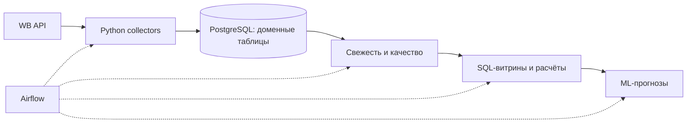
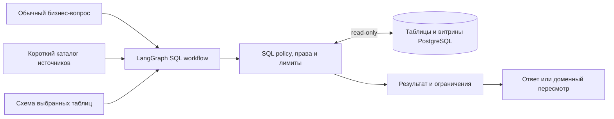

# Архитектура ETL и SQL-аналитики

Платформа состоит из контура подготовки данных и отдельного контура исследования по вопросу пользователя. Этот публичный репозиторий содержит ETL, SQL-схемы, витрины, ML и существующие AI-модули. SQL-агент реализован в отдельном backend; его исходники и рабочие журналы в эту копию не перенесены.

## Разделение ответственности

| Компонент | Ответственность | Где находится |
| --- | --- | --- |
| Python collectors | Получение данных WB, нормализация, повторные загрузки и сохранение прогресса | Модули источников этого репозитория |
| Airflow | Расписания кабинетов, зависимости загрузок, проверки и обновление витрин | `airflow_home/dags/` |
| PostgreSQL | Доменные таблицы, история срезов, SQL-витрины и функции расчётов | DDL в `tables/`; данные вне Git |
| ML и существующие AI-модули | Прогнозы, анализ карточек/конкурентов, объяснения | `ML/`, `WB_sku_ai_analysis/`, `wb_price_ai_analysis/` |
| SQL-агент | Выбор источников и полей под вопрос, генерация и проверка SQL | LangGraph в отдельном backend |
| SQL-исполнитель | Проверка прав и допустимого SQL, лимиты, выполнение и результат с метаданными | Business core отдельного backend |
| Доменный анализ | Использование результата, пересмотр гипотез и формирование вывода | Отдельный backend |
| Поиск по API-документации | Поиск описаний API через embeddings/pgvector | `scripts/`; собственный набор документов |

Airflow и LangGraph решают разные задачи: первый управляет обновлением данных, второй — шагами интерактивного анализа. Для SQL-вопроса не требуется запускать загрузку из WB заново.

## Как данные готовятся к чтению

[Основной DAG](../airflow_home/dags/dag_daily_pipeline_master.py) разделяет строгую основную ветку и рекламную ветку best-effort. Рекламные витрины обновляются после собственных проверок свежести и качества. Поэтому успешное завершение одной ветки не доказывает готовность всех источников.

[Канонические схемы](../tables/DOMAIN_SCHEMA_MAP.md): `sales`, `supply`, `marketing`, `pricing`, `finance`, `analytics_ai`. `reports` сохраняется как compatibility namespace. SQL-агент должен получать реальные имена и смысл объектов из каталога конкретной БД.

## Как SQL-агент использует данные

Модель выбирает разрешённые источники под вопрос. Исполнитель проверяет SQL и выполняет чтение отдельной ограниченной ролью. Прямой результат сохраняет доступную привязку к исходным строкам; производные выборки могут иметь непроверенные единицы, grain и lineage, которые нельзя автоматически выдавать за канонический бизнес-показатель.

Список таблиц в каталоге не является разрешением читать любую БД. Подключение и права выбираются сервером. Для проверенных native-профилей исполнитель дополнительно ограничивает SKU и период; у остальных исследовательских источников автоматическое ограничение по SKU/датам не обещается. Их особенности должны быть явно указаны в доступной модели схеме.

## Что связывает ETL и backend

Связь проходит через PostgreSQL и описание данных, а не через копирование ETL-кода в агент.

Для источника нужны:

- реальное имя таблицы/представления и смысл одной строки;
- ключи, идентификаторы SKU/кампаний и даты;
- смысл полей, единицы и особенности агрегации;
- различие времени события, окна отчёта и времени загрузки;
- условия полноты, свежести и происхождения;
- ограничения объединений, повторные снимки и возможный fan-out.

В каталоге описывается информация, подтверждённая схемой, кодом загрузки и проверками. Отсутствующая lineage означает неизвестное происхождение. Успешный SELECT сам по себе не доказывает, что период собран полностью.

Например, рекламная выручка может быть NULL, а полная загрузка проверяется отдельно через watermark. Эти условия уже закреплены [ETL-тестами атрибуции](../tests/test_marketing_fullstats_attribution_contract.py); SQL-анализ должен сохранять их смысл.

Численные прогнозы и утверждённые финансовые формулы остаются в ML/SQL/калькуляторах. Свободный SQL служит исследованию, а включение фактов в доменный вывод проходит существующие проверки доказательств.

## Граница публичного репозитория

В этой копии нет SQL-исполнителя, сервисной аутентификации, хранилища состояния и кода запуска агента из backend. Установка зависимостей ETL не запускает SQL-агента. Связанная рабочая реализация хранится в приватном backend.

Документация показывает место реализованного компонента в общей системе. Публичное воспроизводимое демо с синтетическими данными — отдельный следующий шаг: оно должно переиспользовать рабочий компонент и иметь собственную проверку запуска. [Текущий статус](sql-agent.md#статус-и-проверки).
